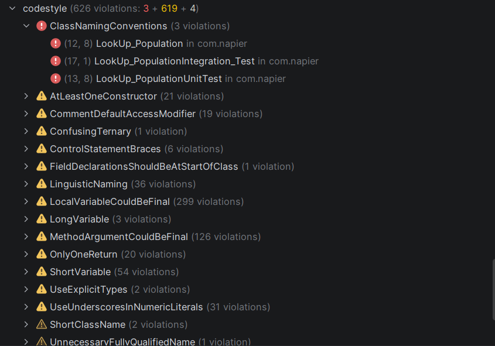
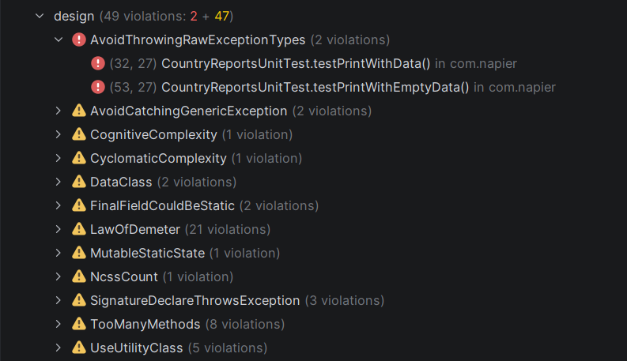

## Code Quality Analysis

The Population Report System was analysed using PMD and Error Prone to identify potential code quality issues, including naming conventions, exception handling, coding style, and maintainability.

PMD reported several code quality warnings, including ClassNamingConventions and AvoidThrowingRawExceptionTypes.

The ClassNamingConventions warnings were identified in LookUp_Population, LookUp_PopulationIntegration_Test, and LookUp_PopulationUnitTest because their class names did not fully follow standard Java naming conventions.

Additional PMD results highlighted design issues in CountryReportsUnitTest, particularly the use of broad exception types in test methods.

These warnings help identify areas where the code can be improved to follow Java best practices and maintain consistent coding standards.

## Details of Recent Code Quality Findings

### Naming Conventions:

PMD identified ClassNamingConventions violations in the following classes:

- LookUp_Population
- LookUp_PopulationIntegration_Test
- LookUp_PopulationUnitTest

These class names should follow Java PascalCase naming conventions without underscores.

Renaming the classes to LookUpPopulation, LookUpPopulationIntegrationTest, and LookUpPopulationUnitTest would improve consistency and readability.

### Exception Handling:

PMD reported AvoidThrowingRawExceptionTypes warnings in CountryReportsUnitTest, specifically in:

- testPrintWithData()
- testPrintWithEmptyData()

These warnings indicate that broad exception types should be replaced with more specific exceptions where possible.

Using specific exceptions, such as SQLException when appropriate, makes error handling clearer and improves code maintainability.

### Testing and Code Coverage:

JUnit unit tests and integration tests were added to verify the functionality of the Population Report System.

Unit tests check population calculations, report formatting, and validation without requiring a database connection.

Integration tests verify database connectivity and the generation of continent, region, and country population reports.

JaCoCo is used to measure test coverage, while Codecov is configured to display coverage results after successful test execution and report uploads.

### Coding Standards:

The PMD analysis highlighted areas where Java naming conventions and exception-handling practices could be improved.

The identified warnings provide guidance for maintaining a consistent code structure and reducing potential maintenance issues.

### Rule Coverage:

The codebase is checked using PMD and Error Prone to identify potential problems related to coding style, design, maintainability, and programming practices.

The PMD results provide a basis for future improvements and help ensure that the Population Report System follows established Java coding standards.
