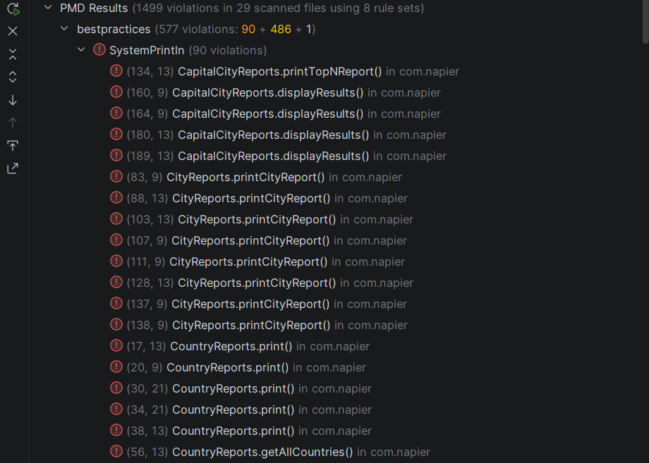
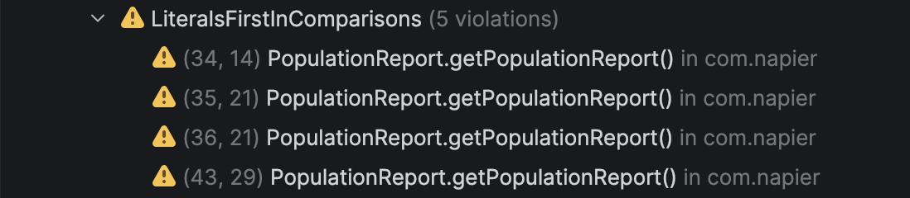
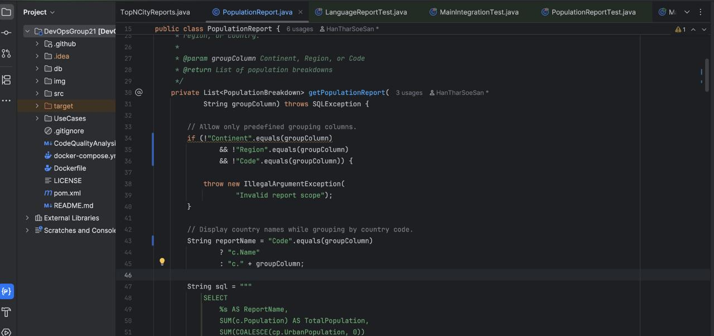
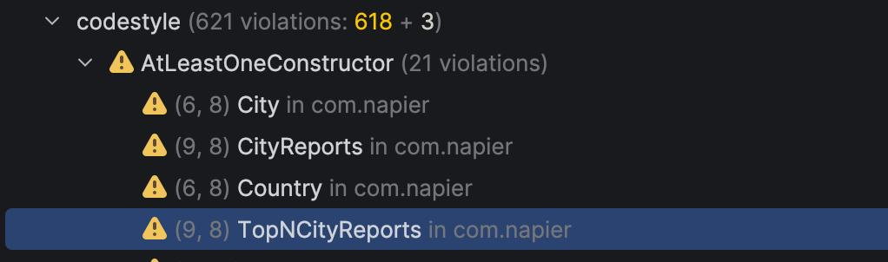
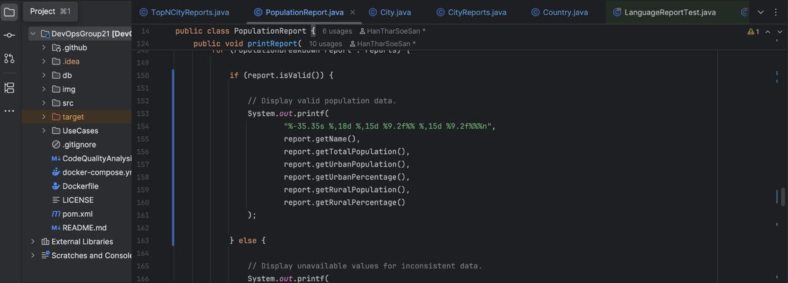
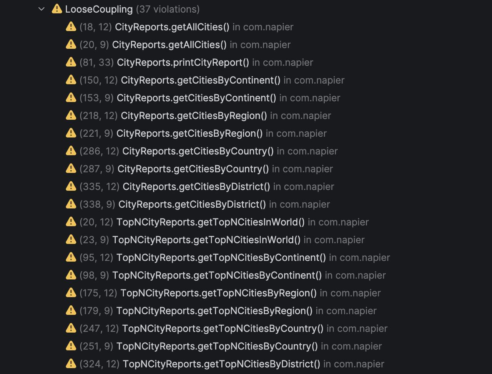

## Code Quality Analysis














The Population Report System was analyzed using PMD and Error Prone to identify potential code quality issues, including coding style, naming conventions, exception handling, class design, and maintainability.

The latest PMD analysis identified several warnings, including LiteralsFirstInComparisons, AtLeastOneConstructor, ConfusingTernary, FieldDeclarationsShouldBeAtStartOfClass, and LooseCoupling.

These warnings were identified across several classes, including PopulationReport, City, Country, CityReports, and TopNCityReports.

The analysis highlighted opportunities to improve code readability, class structure, conditional statements, and the relationships between components.

Although these findings do not necessarily indicate functional errors, they provide useful guidance for improving code quality and maintaining consistent Java programming standards.

## Details of Recent Code Quality Findings

### Literal-First Comparisons:

PMD identified five LiteralsFirstInComparisons violations associated with the PopulationReport class, particularly in the getPopulationReport() method.

The warnings were related to comparisons involving the groupColumn variable and string literals such as "Continent", "Region", and "Code".

The comparison statements were updated to place string literals before the equals() method calls.

For example:

```java
"Continent".equals(groupColumn)
```

This approach helps prevent NullPointerException when the variable being compared is null.

Using literal-first comparisons improves defensive programming practices and reduces the possibility of runtime errors.

### Constructor Requirements:

PMD identified 21 AtLeastOneConstructor violations across several classes.

The reported classes included:

- City
- CityReports
- Country
- TopNCityReports

These warnings indicate that the classes do not explicitly declare constructors.

Adding constructors where appropriate can make object initialization clearer and improve class design.

For data model classes such as City and Country, explicit constructors can also provide a clear way to initialize important attributes.

For utility classes containing only static methods, a private constructor may be more appropriate to prevent unnecessary object creation.

### Conditional Logic:

PMD reported one ConfusingTernary violation in the PopulationReport.printReport() method.

The warning was associated with conditional logic used to distinguish valid population data from inconsistent population data.

The conditional statement was improved by checking valid population data first.

For example:

```java
if (report.isValid()) {
    // Display valid population data.
} else {
    // Display unavailable values for inconsistent data.
}
```

This structure makes the code easier to read by handling the normal case before the exceptional case.

It also improves the clarity of report formatting and reduces unnecessary complexity in conditional statements.

### Field Declaration Placement:

PMD identified one FieldDeclarationsShouldBeAtStartOfClass violation in the City class.

The warning occurred because the country field was declared after several getter and setter methods.

To improve the organisation of the class, field declarations should be grouped together at the beginning of the class, before constructors and methods.

For example:

```java
private int id;
private String name;
private String countryCode;
private String district;
private int population;
private Country country;
```

Grouping related fields makes the class structure easier to understand and maintain.

### Loose Coupling:

PMD identified 37 LooseCoupling violations across multiple report classes.

These warnings appeared in methods from:

- CityReports
- TopNCityReports

Examples included:

- getAllCities()
- printCityReport()
- getCitiesByContinent()
- getCitiesByRegion()
- getCitiesByCountry()
- getCitiesByDistrict()
- getTopNCitiesInWorld()
- getTopNCitiesByContinent()
- getTopNCitiesByRegion()
- getTopNCitiesByCountry()
- getTopNCitiesByDistrict()

These warnings were mainly associated with using concrete collection types such as ArrayList instead of more general interfaces.

For example, the following declaration:

```java
ArrayList<City> cities = new ArrayList<>();
```

Can be improved by using:

```java
List<City> cities = new ArrayList<>();
```

Using the List interface reduces dependencies on specific collection implementations and makes the code more flexible.

This approach also supports better maintainability and future modifications.

### Testing and Code Coverage:

JUnit unit tests and integration tests were implemented to verify the functionality of the Population Report System.

Unit tests are used to check population calculations, data validation, report formatting, and other application logic without requiring a database connection.

Integration tests verify database connectivity, SQL execution, and the generation of population reports for continents, regions, and countries.

JaCoCo is used to measure code coverage, while Codecov is configured to display coverage results after successful test execution and report uploads.

The testing process helps identify potential defects and ensures that important application features behave as expected.

### Coding Standards:

The latest PMD analysis identified several areas where coding standards could be improved.

These included:

- Placing string literals first in comparisons.
- Declaring constructors explicitly where appropriate.
- Simplifying conditional statements.
- Grouping field declarations at the beginning of classes.
- Using collection interfaces instead of concrete implementations.

Addressing these warnings improves readability, maintainability, and consistency across the codebase.

### Rule Coverage:

The codebase is analysed using PMD and Error Prone to identify potential programming errors, coding style problems, design issues, and maintainability concerns.

The latest PMD results highlight several categories of code quality violations, including LiteralsFirstInComparisons, AtLeastOneConstructor, ConfusingTernary, FieldDeclarationsShouldBeAtStartOfClass, and LooseCoupling.

The wider analysis provides guidance for continuous improvement and helps the Population Report System follow established Java development practices.

Further code quality improvements can be made by reviewing the remaining PMD warnings and applying suitable refactoring techniques without changing the application's expected functionality.